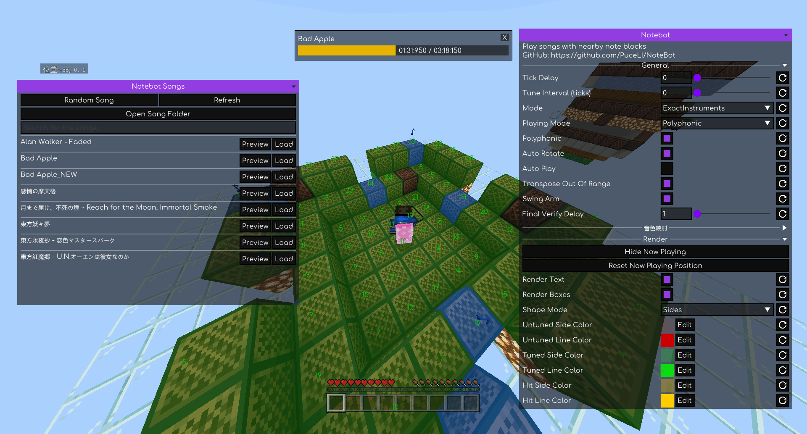

# NoteBot

NoteBot is a client-side feature that automatically plays songs by tuning and hitting nearby Note Blocks based on loaded NBS (Noteblock Studio) files.

  

---

## Installation

Make sure the **LeviLamina** dependency is installed.

### Installing with LIP

`lip install github.com/PuceLi/NoteBot`

### Manual Installation

- Download `NoteBot-client-windows-x64.zip` from [Releases](https://github.com/PuceLi/NoteBot/releases).
- Install via **LeviLauncher**, or extract the files into `/path/to/your/mods`.
- Launch the game.

## Usage

### Preparing Songs

1. On the main interface, click **Open Song List** → **Open Song Folder**, then place your `.nbs` files into the folder.
2. Once added, click **Refresh** to update the list.

### Loading & Playing

1. Enter a world, stand near the note blocks you want to use, and switch to Survival Mode.
2. Press `L` to open the NoteBot interface (the hotkey can be rebound under **Keybindings**).
3. Click **Open Song List**, find your song, and click **Load**.
4. Return to the main menu and click **Play**. The mod will scan nearby note blocks, match the required pitches (tuning them beforehand if necessary), and begin playing.

You can also click **Scan Note Blocks** first to verify nearby block matching. The song status will display the number of available note blocks and any missing notes; expand **Missing Notes** to view the specific missing pitches.

### Previewing Songs

Click **Play** directly in the song list to preview a song without needing to enter a world.

## Project Status

This mod currently has several known issues.
[Issue](https://github.com/PuceLi/NoteBot/issues) is welcome below.

## Third-Party Credits

- [Meteor Client(GPL-3.0)](https://github.com/MeteorDevelopment/meteor-client) - Ported UI to this project

## Vedio

[YouTuBe](https://youtu.be/JvPiIVKTFDY)

[BiliBili](https://www.bilibili.com/video/BV1mmHk6dEop)