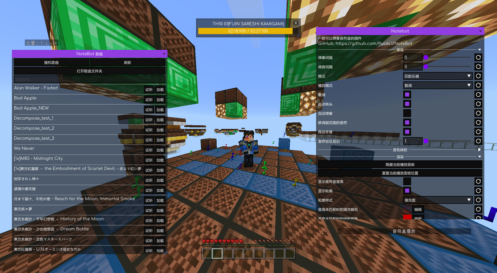

# NoteBot

NoteBot is a client-side feature that automatically plays songs by tuning and hitting nearby Note Blocks based on loaded NBS (Noteblock Studio) files.

  

---

## Installation

Make sure the **LeviLamina** dependency is installed.

### Installing with LIP

`lip install github.com/PuceLi/NoteBot`

### Manual Installation

- Download `NoteBot-client-windows-x64.zip` from [Releases](https://github.com/PuceLi/NoteBot/releases).
- Install via **LeviLauncher**, or extract the files into `/path/to/your/mods`.
- Launch the game.

## Usage

### Preparing Songs

1. On the main screen, click **Open Song GUI** → **Open Song Folder**, and place your `.nbs` song files into the folder
2. Once the files are added, click **Refresh** to update the list

### Loading and Playing

1. Enter a world, stand near the note blocks you want to use, and switch to Survival mode
2. Press `L` to open the NoteBot main UI; you can change the keybinding under **Mod Settings** → **Bind**
3. Click **Open Song GUI**, then click **Load** next to the song you want to use
4. Return to the main UI and click **Play** or press `P`. The mod will scan nearby note blocks, match the required notes, tune the note blocks if needed, and start playing

You can also click **Scan NoteBlocks** first to check the matching status of nearby note blocks. The song status will display the number of found note blocks and missing notes; expand **Missing notes** to view the specific missing items.

Under **General**, you can configure **Concurrent Tune Blocks** to tune multiple distinct note blocks simultaneously; this feature may not work in multiplayer.

### Previewing Songs

Click **Preview** in the song list to preview a song without entering a world.

### Backup and Import

Open **Mod Settings → Mod Data** from the top menu to back up or import mod configurations and songs.

## Project Status

Some features are currently in testing. Download available via [Action](https://github.com/PuceLi/NoteBot/actions).

This mod still has many unknown issues; feel free to report them in [Issues](https://github.com/PuceLi/NoteBot/issues).

Due to limited development time, updates for this project may be relatively slow.

## Credits

- [Meteor Client (GPL-3.0)](https://github.com/MeteorDevelopment/meteor-client) - UI ported to this project
- [rsnbs (MIT)](https://github.com/omninbs/rsnbs) - Referenced for its NBS parser implementation

## Video Showcase

[YouTube](https://youtu.be/JvPiIVKTFDY)

[Bilibili](https://www.bilibili.com/video/BV1mmHk6dEop)
