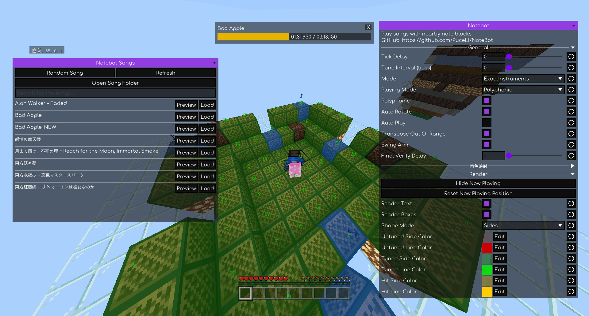

# NoteBot

NoteBot 是一个可以加载的 NBS（Noteblock Studio）文件弹奏音符盒的客户端模组

  

---

## 安装

请确保已安装 **LeviLamina** 依赖

### 使用 LIP 安装

`lip install github.com/PuceLi/NoteBot`

### 手动安装

- 从 [Releases](https://github.com/PuceLi/NoteBot/releases) 下载 `NoteBot-client-windows-x64.zip`
- 使用 **LeviLauncher** 安装，或将文件解压到 `/path/to/your/mods`
- 启动游戏

## 使用方法

### 准备歌曲

1. 在主界面点击 **打开歌曲列表** → **打开歌曲文件夹**，将 `.nbs` 歌曲文件放入文件夹内
2. 文件放入后，点击 **刷新** 更新列表

### 加载与演奏

1. 进入世界，靠近要使用的音符盒，并切换到生存模式
2. 按 `L` 打开 NoteBot 主界面，可以在 **按键绑定** 区域更改打开界面的按键
3. 点击 **打开歌曲列表**，在歌曲列表中点击需要加载的歌曲后的 **加载**
4. 回到主界面，点击 **弹奏**，插件会扫描附近音符盒、匹配歌曲所需音符，并在需要时先调整音符盒音高，然后开始演奏

可以先点击 **扫描音符盒** 查看附近音符盒的匹配情况,歌曲状态会显示找到的音符盒数量和缺少的音符；展开 **缺失的音符** 可查看具体缺项

### 试听歌曲

在歌曲列表点击 **播放** 可以试听歌曲，无需进入世界

## 项目状态

此模组目前仍有很多未知的问题，欢迎在 [Issue](https://github.com/PuceLi/NoteBot/issues) 中反馈

由于开发精力有限，该项目更新速度会比较慢

## Credits

- [Meteor Client(GPL-3.0)](https://github.com/MeteorDevelopment/meteor-client) - 移植 UI 到此项目

## 视频演示

[YouTube](https://youtu.be/JvPiIVKTFDY)

[哔哩哔哩](https://www.bilibili.com/video/BV1mmHk6dEop)
